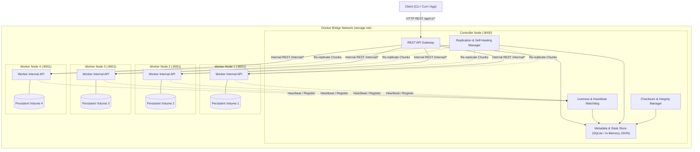
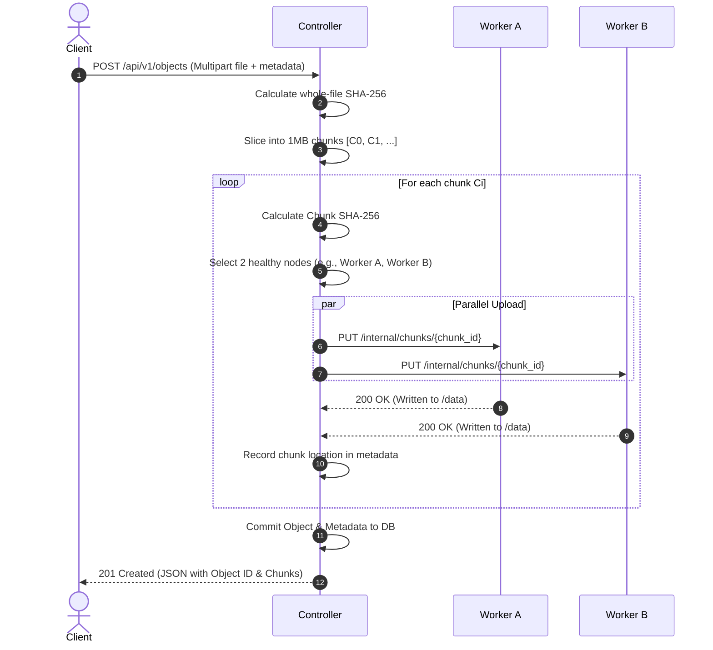
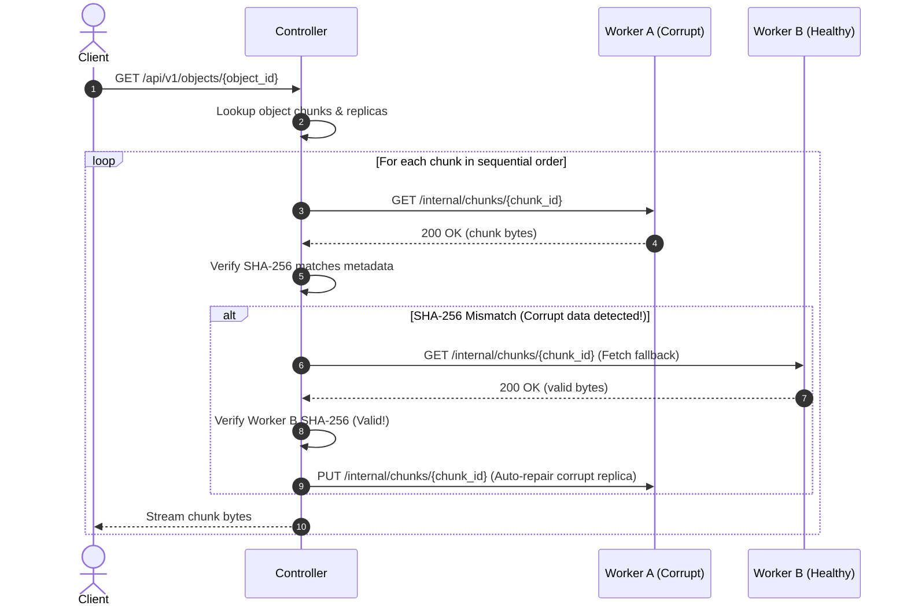

# Architecture Design Document
# Mini Distributed Cloud Object Store

## 1. System Overview

The **Mini Distributed Cloud Object Store** is a distributed, fault-tolerant, chunk-based object storage service modeled after modern distributed file systems (such as Google File System and Hadoop HDFS). The system is capable of storing, retrieving, and managing arbitrary binary objects (documents, images, videos, audio, compressed archives) by splitting them into fixed-size chunks (1 MB) and distributing them across multiple storage worker nodes with a replication factor of 2.

The entire system is containerized using **Docker** and orchestrated using **Docker Compose** on an isolated internal bridge network, without relying on Kubernetes.

---

## 2. System Configuration & Constraints

| Parameter | Specification | Details |
| :--- | :--- | :--- |
| **Controller Nodes** | 1 Node | Acts as the cluster coordinator, metadata catalog, and API gateway |
| **Storage / Worker Nodes** | 4 Nodes | Store data chunks on local persistent storage |
| **Client Nodes** | 1 or more | Interact with the system via standard HTTP REST APIs |
| **Chunk Size** | 1 MB (1,048,576 bytes) | Final chunk may be $\le$ 1 MB |
| **Replication Factor** | 2 | Every chunk must have two copies stored on distinct workers |
| **Deployment** | Docker & Docker Compose | Local execution with bridge network and persistent volumes |
| **Worker Storage** | Persistent Storage | Docker volume mounts (`/data` per worker) |
| **Orchestration Rule** | No Kubernetes | Worker orchestration, failure handling, and self-healing handled by Controller |

---

## 3. High-Level Architecture Diagram



---

## 4. Architectural Components

### 4.1 Controller Node (Coordinator)
The Controller maintains the cluster's single source of truth. It exposes the public Client REST API, manages metadata, routes chunk traffic, monitors worker health, and enforces the replication factor.

* **Client REST API Gateway**: Receives uploads, downloads, metadata modifications, listings, and deletion requests.
* **Metadata Store**: Persists metadata for both objects and individual chunks:
  * **Object Record**: `object_id`, `name`, `size`, `content_type`, `created_at`, `modified_at`, `checksum` (SHA-256 of complete object), `total_chunks`, and user-defined `metadata` (JSON key-value pairs).
  * **Chunk Record**: `chunk_id`, `object_id`, `chunk_index`, `size`, `checksum` (SHA-256 of chunk), and `replicas` (list of active worker IDs hosting this chunk).
  * **Worker Registry**: `worker_id`, `host`, `port`, `status` (`HEALTHY`, `OFFLINE`), `last_heartbeat`, `chunk_count`.
* **Heartbeat & Liveness Watchdog**:
  * Receives periodic heartbeats from workers (`POST /internal/workers/heartbeat`).
  * Runs a background timer. If a worker fails to send a heartbeat within $T_{\text{timeout}}$ (e.g., 6 seconds), the worker is marked `OFFLINE`.
* **Replication & Self-Healing Manager**:
  * Periodically scans chunk replica tables or triggers on worker failure.
  * When a chunk has fewer than 2 active replicas (under-replicated), it coordinates copy transfer from a surviving worker to another available healthy worker.
  * When a recovered worker reconnects with existing chunks, resolves over-replicated or stale chunks.
* **Integrity Manager**:
  * Compares chunk checksums against recorded SHA-256 hashes on read operations.
  * If a corrupted chunk is identified, fetches the healthy replica from the second worker, serves it to the client, and repairs the corrupted copy.

### 4.2 Storage / Worker Nodes (Workers 1 to 4)
Workers are stateless execution units with attached persistent disk storage:
* Expose internal HTTP endpoints on port `8001`.
* Store chunk files in their mounted volume (`/data/{chunk_id}`).
* Send registration on startup to `POST /internal/workers/register`.
* Send continuous heartbeats every 2 seconds to `POST /internal/workers/heartbeat`.
* Serve chunk I/O (`PUT`, `GET`, `DELETE`) and report chunk inventory (`GET /internal/workers/{worker_id}/chunks`).

---

## 5. Chunking, Placement, and Replication Protocol

### 5.1 Chunk Identification
* Each uploaded object is assigned a unique UUIDv4 `object_id`.
* The object payload is split into fixed 1 MB slices ($1{,}048{,}576$ bytes).
* Each chunk receives a deterministic unique identifier:
  $$\text{chunk\_id} = \{\text{object\_id}\}\_\{\text{chunk\_index}\}$$
  *(e.g., `d12e8b60-1234_chunk_0`, `d12e8b60-1234_chunk_1`)*

### 5.2 Worker Placement Strategy
To ensure even distribution and fault isolation:
1. For each chunk $i$, the Controller selects 2 distinct, currently healthy workers $W_A$ and $W_B$.
2. Selection algorithm: **Least-Loaded Round-Robin** (workers with the lowest chunk count are prioritized, rotating across the cluster).
3. Invariance rule: A chunk's primary and secondary copies must never be placed on the same worker node ($W_A \neq W_B$).

---

## 6. API Specifications

### 6.1 Client REST API (Public Interface)

| Method | Endpoint | Description | Success Status | Error Statuses |
| :--- | :--- | :--- | :--- | :--- |
| `POST` | `/api/v1/objects` | Upload binary object via `multipart/form-data` | `201 Created` | `400`, `500`, `503` |
| `GET` | `/api/v1/objects/{object_id}` | Download complete object as binary stream | `200 OK` | `404`, `500`, `503` |
| `GET` | `/api/v1/objects/{object_id}/metadata` | Retrieve system & custom metadata (JSON) | `200 OK` | `404`, `500` |
| `PATCH`| `/api/v1/objects/{object_id}/metadata` | Update/add custom key-value metadata | `200 OK` | `400`, `404`, `500` |
| `DELETE`| `/api/v1/objects/{object_id}` | Delete object and all associated chunks | `204 No Content` | `404`, `500` |
| `GET` | `/api/v1/objects` | List all stored objects with pagination | `200 OK` | `500` |

#### Payload Examples:

**1. Upload Request:**
```http
POST /api/v1/objects HTTP/1.1
Content-Type: multipart/form-data; boundary=----WebKitFormBoundary

------WebKitFormBoundary
Content-Disposition: form-data; name="file"; filename="sample.mp4"
Content-Type: video/mp4

<binary data>
------WebKitFormBoundary
Content-Disposition: form-data; name="metadata"
Content-Type: application/json

{"department": "engineering", "environment": "production"}
------WebKitFormBoundary--
```

**2. Upload Response (`201 Created`):**
```json
{
  "object_id": "a92c3f81-54de-49c0-9cf8-61d013ba8123",
  "name": "sample.mp4",
  "size": 2621440,
  "content_type": "video/mp4",
  "created_at": "2026-11-16T15:30:00Z",
  "modified_at": "2026-11-16T15:30:00Z",
  "checksum": "d54d9b62649a2a90f...",
  "total_chunks": 3,
  "chunks": [
    {
      "chunk_id": "a92c3f81-54de-49c0-9cf8-61d013ba8123_chunk_0",
      "size": 1048576,
      "replicas": ["worker1", "worker2"]
    },
    {
      "chunk_id": "a92c3f81-54de-49c0-9cf8-61d013ba8123_chunk_1",
      "size": 1048576,
      "replicas": ["worker3", "worker4"]
    },
    {
      "chunk_id": "a92c3f81-54de-49c0-9cf8-61d013ba8123_chunk_2",
      "size": 524288,
      "replicas": ["worker1", "worker4"]
    }
  ],
  "custom_metadata": {
    "department": "engineering",
    "environment": "production"
  }
}
```

---

### 6.2 Internal Worker API (Private Controller-Worker Interface)

| Method | Endpoint | Purpose |
| :--- | :--- | :--- |
| `POST` | `/internal/workers/register` | Worker announces its address, port, and ID on boot |
| `POST` | `/internal/workers/heartbeat` | Worker reports liveness periodically (every 2s) |
| `PUT` | `/internal/chunks/{chunk_id}` | Store raw chunk binary on worker disk |
| `GET` | `/internal/chunks/{chunk_id}` | Retrieve raw chunk binary from worker |
| `DELETE` | `/internal/chunks/{chunk_id}` | Delete raw chunk binary file from worker disk |
| `GET` | `/internal/workers/{worker_id}/chunks` | Return array of all chunk IDs currently stored on worker |

---

## 7. Core Workflows & Protocols

### 7.1 Object Upload Flow


### 7.2 Object Download & Integrity Verification Flow


---

## 8. Failure Detection & Self-Healing (Maintaining Copies)

### 8.1 Worker Failure Detection
1. **Heartbeat Cadence**: Every 2 seconds, each worker sends `POST /internal/workers/heartbeat`.
2. **Timeout Threshold**: The Controller evaluates worker liveness. If $\Delta t = (t_{\text{current}} - t_{\text{last\_heartbeat}}) \ge 6 \text{ seconds}$, the Controller changes the worker state from `HEALTHY` to `OFFLINE`.
3. **Grace Period**: When a node is marked `OFFLINE`, it is excluded from future chunk allocations.

### 8.2 Self-Healing (Re-Replication)
When `worker2` stops (`docker stop worker2`):
1. **Under-Replication Scan**: The Controller identifies all chunks where `worker2` was registered as a replica. For each chunk, the active replica count drops from 2 to 1.
2. **Target Node Selection**: The Controller identifies an active worker (e.g., `worker3` or `worker4`) that does not already store this chunk.
3. **Data Replication**:
   * Controller fetches the surviving valid copy from `worker1`: `GET /internal/chunks/{chunk_id}`.
   * Controller sends the copy to `worker3`: `PUT /internal/chunks/{chunk_id}`.
   * Controller updates the metadata table: `replicas: ["worker1", "worker3"]`.
4. Replication factor 2 is restored across active workers.

### 8.3 Node Re-Integration
When the node restarts (`docker start worker2`):
1. `worker2` reboots and calls `POST /internal/workers/register`.
2. Controller marks `worker2` as `HEALTHY`.
3. Controller inspects chunks hosted on `worker2` via `GET /internal/workers/worker2/chunks`.
4. **Reconciliation Logic**:
   * If any chunk was re-replicated elsewhere during downtime, retaining it would exceed the replication factor of 2.
   * The Controller instructs `worker2` to clean up surplus copies via `DELETE /internal/chunks/{chunk_id}`.
   * If a chunk was not yet re-replicated, the Controller simply increments the active replica count back to 2.

---

## 9. Data Integrity & Bit-Rot Protection

To satisfy Section 8 of the specification:
1. **Cryptographic Checksumming**: During chunking, the Controller calculates a SHA-256 digest for every individual chunk and stores it in the metadata store.
2. **On-Read Verification**: Every chunk retrieved from a worker during object download or internal replication is validated against its recorded SHA-256 hash.
3. **Silent Corruption Handling**:
   * If a chunk hash fails validation, the Controller marks that specific worker's copy as corrupt.
   * The Controller falls back to the secondary replica.
   * Once validated, the good replica is written back to the corrupted worker (`PUT /internal/chunks/{chunk_id}`), automatically repairing disk corruption without client disruption.
4. **Intentional Corruption Demonstration**:
   * A script or command will modify random bytes inside a worker volume file (`/data/{chunk_id}`).
   * Subsequent download succeeds seamlessly via the second replica and heals the corrupted file.

---

## 10. Deployment Model (Docker & Docker Compose)

The entire cluster runs locally using Docker Compose. Persistent volumes ensure that worker storage survives container restarts (`docker stop` / `docker start`).

### Directory Layout
```
DistributedCloudStore/
├── ARCHITECTURE.md          # This architecture specification
├── README.md                # Project readme & setup instructions
├── docker-compose.yml       # Cluster orchestration (1 Controller, 4 Workers)
├── controller/
│   ├── Dockerfile
│   ├── requirements.txt
│   └── src/
│       ├── main.py          # FastAPI / Flask entrypoint
│       ├── metadata.py      # SQLite / In-memory metadata store
│       ├── replication.py   # Liveness monitor & auto-healing loop
│       └── integrity.py     # Checksum calculation & validation
└── worker/
    ├── Dockerfile
    ├── requirements.txt
    └── src/
        ├── main.py          # Worker API (PUT/GET/DELETE chunks, heartbeat)
        └── storage.py       # Local file persistence in /data
```

### Docker Compose Architecture
* **Controller**: Exposes port `8000:8000` to the host machine for client interactions.
* **Workers**: Expose port `8001` within the private `storage-net` bridge network.
* **Persistent Volumes**:
  * `worker1_data` mounted at `/data` on `worker1`
  * `worker2_data` mounted at `/data` on `worker2`
  * `worker3_data` mounted at `/data` on `worker3`
  * `worker4_data` mounted at `/data` on `worker4`

---

## 11. Verification Matrix (Project Demonstration Alignment)

| Requirement | Implementation Mechanism | Validation Method |
| :--- | :--- | :--- |
| **1. Object Storage** | Binary streaming, multipart upload, deterministic chunk assembly | Upload and download object, compare `diff` or SHA-256 |
| **2. Chunking & Distribution** | 1 MB chunk slicing, round-robin placement | Inspect chunk breakdown and storage locations via API |
| **3. Replication Factor (2)** | Each chunk written to 2 distinct worker volumes | Verify each chunk ID exists in exactly two worker directories |
| **4. Metadata Management** | Dedicated endpoints for system & custom metadata; JSON schema | Update metadata via `PATCH`, verify with `GET /metadata` without re-uploading file |
| **5. Worker Failure Handling** | Heartbeat watchdog + under-replication healing worker | `docker stop worker2`, verify file download still works, inspect re-replication on healthy workers, then `docker start worker2` |
| **6. Data Integrity** | Per-chunk SHA-256 verification and replica auto-healing | Tamper with a chunk file directly on worker disk; download object, confirm success, and verify file was repaired |
